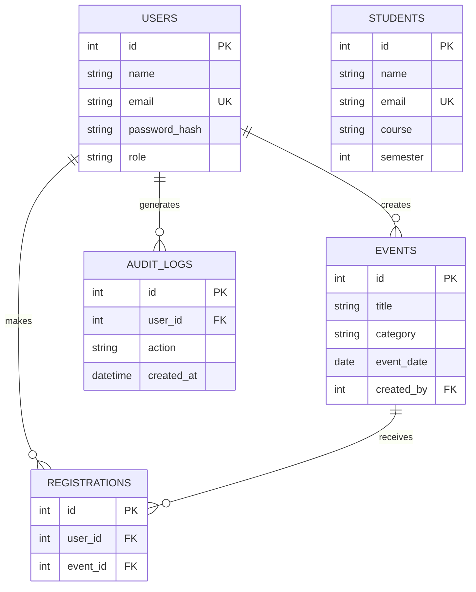

# StudentHub ER Model

`users.email` and `students.email` are unique. `registrations` uses a unique `(user_id, event_id)` pair to prevent duplicate event registration. Foreign keys define ownership and cleanup behaviour.
